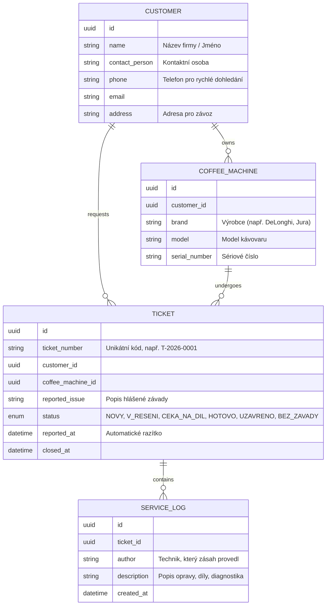

# AGENTS.md – Evidence servisních tiketů (MatSERVIS)

Tento dokument slouží jako hlavní specifikace, architektonický kontext a sada pokynů pro AI agenty (a vývojáře) pracující na tomto repozitáři v rámci předmětu Pokročilé programování (PPRO).

---

## 1. Kontext klienta a projektu

* **Klient:** Jiří Matoušek, firma **MatSERVIS**.
* **Předmět činnosti:** Opravy a servis profesionálních kávovarů pro kanceláře a restaurace. Tým 4 lidí, 2× týdně rozvoz opravených strojů zákazníkům.
* **Současný stav (problém):**
  * Zákazníci hlásí závady telefonicky/e-mailem.
  * Záznamy se píší ručně na papír a připevňují ke kávovaru.
  * Ztrácí se servisní historie (při opakované závadě nikdo neví, co se dělalo minule).
  * Zdlouhavé měsíční přepisování papírů do tabulek kvůli fakturaci.
* **Cíl projektu:** Jednoduchá, přehledná webová aplikace pro evidenci servisních zakázek, sledování stavu oprav a uchování servisní historie kávovarů.

---

## 2. Funkční požadavky (MVP)

### FP-01: Evidence a založení tiketu
* **Zadání závady:** Kdo volal (zákazník/kontakt), jakého stroje se to týká (model, sériové číslo/identifikace), popis hlášené závady.
* **Automatické generování:**
  * **Čas nahlášení:** Zapisuje se automaticky ze systému (nikoliv ručním zadáním).
  * **Číslo tiketu:** Unikátní, krátký a snadno čitelný identifikátor do telefonu (např. formát `T-2026-0001` nebo `1001`).

### FP-02: Přehled a stavový dashboard
* Seznam všech aktivních i vyřízených tiketů.
* **Vizuální rozlišení:** Na první pohled musí být jasné, které tikety jsou nevyřízené (barevné štítky, filtry, stavové sloupce).
* Rychlé filtrování podle aktuálního stavu a zákazníka.

### FP-03: Životní cyklus a workflow tiketu
Možnost jednoduše posouvat stav tiketu podle reálného postupu na dílně:
* `NOVÝ / PŘIJATÝ` (vytvořen po telefonátu zákazníka)
* `V ŘEŠENÍ` (technik začal pracovat na stroji)
* `ČEKÁ NA DÍL` (stroj rozebrán, čeká se na náhradní díly od dodavatele)
* `OPRAVENO / HOTOVO` (oprava dokončena, stroj otestován a čeká na rozvoz)
* `PŘEDÁNO / UZAVŘENO` (odvezeno zákazníkovi v rámci pravidelného závozu)
* `ZAMÍTNUTO / BEZ ZÁVADY` (závada se neprojevila nebo byl stroj v pořádku)

### FP-04: Vyhledávání a telefonická podpora
* Rychlé vyhledání tiketů podle:
  * Jména/názvu zákazníka nebo telefonního čísla (zákazník volá a chce odpověď ihned).
  * Čísla tiketu.
  * Sériového čísla / názvu kávovaru.

### FP-05: Servisní deník (Historie oprav)
* Možnost přidávat k tiketu záznamy o provedené práci:
  * Popis úkonu (co se na stroji dělalo, vyměněné díly, čas technika).
  * Historie stroje musí být dohledatelná i při budoucích opravách stejného kávovaru.

---

## 3. Tvrdá pravidla a integrita dat (Na čem klient trvá)

1. **Zákaz fyzického mazání (Auditovatelnost & Soft-delete):**
   * Žádný tiket nesmí z databáze zmizet.
   * Pokud zákazník nahlásí závadu a ukáže se, že se neprojevila, tiket se stornuje/uzavře jako „Bez závady“, ale zůstane navždy dohledatelný v historii.
2. **Lidsky čitelné číslo tiketu:**
   * Číslo tiketu musí být krátké, přirozené a snadno sdělitelné do telefonu zákazníkovi.
3. **Automatická časová razítka:**
   * Čas nahlášení (`created_at`) a změny stavů (`updated_at`) musí nastavovat systém, uživatel je nesmí ručně přepisovat.

---

## 4. Architektonická rozhodnutí (Vyřešení nejasností klienta)

| Otázka ze zadání | Rozhodnutí | Odůvodnění |
| :--- | :--- | :--- |
| **Model zákazníka:** Samostatný záznam vs. textové pole na tiketu? | **Samostatná entita `Customer`** (+ volitelně entita `Appliance`/`CoffeeMachine`). | Klient potřebuje okamžitě vyhledat všechny tikety zákazníka a vidět historii stroje. Volný text by vedl k překlepům a znemožnil spolehlivou historii. |
| **Stavy tiketu:** Jaké přesně stavy systém eviduje? | `NOVÝ`, `V_ŘEŠENÍ`, `ČEKÁ_NA_DÍL`, `HOTOVO`, `UZAVŘENO`, `STORNO_BEZ_ZÁVADY`. | Pokrývá potřeby dílny zmíněné v zadání (práce, čekání na díly, odvoz). |
| **Kdo tiket zakládá:** Zákazník nebo servis? | **Interní uživatel (technik / dispečer MatSERVIS).** | Všichni 4 lidé na dílně mohou zvednout telefon a zaevidovat tiket. Systém je interní dílenský nástroj. |

---

## 5. Navržený doménový model

---

## 6. Rozšiřující funkce (Backlog / Nice-to-have)

Tyto funkce klient zmínil mimochodem, nejsou kritické pro první fázi, ale architektura s nimi musí počítat:
1. **Export do CSV/Excelu:**
   * Export tiketů a servisních úkonů za dané období pro potřeby měsíční fakturace.
2. **SMS / E-mail notifikace zákazníkovi:**
   * Automatické odeslání zprávy při přechodu do stavu `HOTOVO` („Váš kávovar je opraven a připraven k závozu“).

---

## 7. Pokyny pro AI agenty

1. **Udržujte čistou architekturu:** Oddělujte doménovou logiku, přístup k datům a prezentační vrstvu.
2. **UI/UX priorita:** Servisní technici potřebují rychlé a přehledné rozhraní – přehledný dashboard, zřetelné barvy stavů, klávesové zkratky nebo rychlé fulltextové vyhledávání.
3. **Konzistence:** Používejte české termíny pro doménu v UI (Tiket, Zákazník, Kávovar, Servisní záznam) a standardní anglické názvy pro kód a API endpointy.
4. **Validace dat:** Vždy validujte povinná pole při zakládání tiketu a zabraňte nekonzistentním přechodům mezi stavy.
